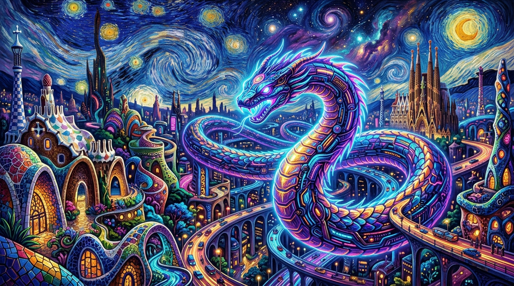

# 🌌⚡ CYBER SNAKE 3D: GAUDÍ × VAN GOGH × CYBERPUNK

[](https://opensource.org/licenses/Apache-2.0)
[](https://react.dev)
[](https://threejs.org)
[](https://socket.io)
[](https://www.typescriptlang.org)
[](https://vitejs.dev)

> **A high-octane 3D real-time multiplayer snake survival arena.**  
> Where the hypnotic swirling celestial brushstrokes of **Vincent van Gogh's *Starry Night*** and the organic serpentine mosaic architecture of **Antoni Gaudí's *Park Güell & Sagrada Família*** collide with blistering **high-tech cyberpunk neon aesthetics**.

---

<p align="center">
  
</p>

---

## 🌟 Vision & Art Direction

**CYBER SNAKE 3D** transforms the classic retro snake formula into an immersive, living art piece and competitive tactical playground:

* **Vincent van Gogh's Celestial Whirlpools:** The skybox and energy trails curl and vibrate with turbulent impasto rhythms, golden crescent moons, and pulsing starlight nebulae.
* **Antoni Gaudí's Biomorphic Trencadís:** The cyber-serpents boast iridescent dragon-scale ceramic tiles and ribbed parabolic bone armors reminiscent of the *Casa Batlló* and *Park Güell* salamander.
* **Cyberpunk Overdrive:** High-frequency neon bloom, holographic tactical radar HUD, plasma jet exhaust thrusters, and procedural synth soundscapes created entirely in real-time.

---

## 🎮 Innovative Gameplay Mechanics

Forget boring glowing dots! In **CYBER SNAKE 3D**, every single item on the field possesses distinct tactical physics, hazards, and survival properties:

<p align="center">
  
</p>

### 🛡️ 3-Strike Hull Integrity & Self-Severing Tail

1. **Self-Cut / Tactical Tail Severing:**
   - If you run into your own body, your head won't instantly die!
   - Instead, your snake **severs the collided tail section**, dropping glowing energy orbs into the arena for others (or yourself) to reclaim.
   - Each self-collision costs **1 Hull Integrity Strike** and triggers a tactical recoil shield.
   - **3 Strikes = Critical Meltdown** and game over.

2. **Autonomous Cyber-Viper Bots:**
   - The arena is never empty. Autonomous AI bots (`NeonViper`, `CyberPhantom`, `GlitchDragon`, `ApexCobra`, `ZeroDrift`) patrol the battlefield, hunt high-value relics, evade mines, and boost to cut you off.

---

### 🔮 Relics & Orbs Matrix

| Icon | Item | Effect & Strategy | Duration / Value |
| :---: | :--- | :--- | :---: |
| ⚡ | **Hyper Boost (Overdrive)** | Maximum warp speed without expending snake mass or score. Leaves a blazing plasma trail. | `6.5s` |
| 🛡️ | **Aegis Shield (Immortality)** | Complete invulnerability to enemy heads, laser walls, and skull mines. Deflects damage harmlessly. | `8.0s` |
| 🧲 | **Gravitational Vortex** | Generates a 45-unit electromagnetic tractor beam pulling all nearby gems and orbs directly into your maw. | `7.0s` |
| ❄️ | **Absolute Frost** | Freezing blast that slows down your steering and movement speed by 45%. Highly dangerous in combat! | `5.0s` |
| 👻 | **Phase Shift (Ghost Mode)** | Disintegrates physical collision with other snakes' bodies. Slither straight through rivals undetected! | `6.0s` |
| 💎 | **Mega Gem Cluster** | Massive golden icosahedron granting huge growth and bonus score points. | `+20 Mass` |
| 💀 | **Proximity Skull Mine** | High-explosive hazard! Detonates on impact, deducting 1 Hull Strike and blasting off 35% of your tail! | *Instant Hazard* |
| 🔵 | **Standard Cyber Orb** | Pure radiant energy for continuous serpentine growth. | `+1 Mass` |

---

<p align="center">
  
</p>

---

## 🕹️ Controls & Multi-Platform Support

Designed with full cross-device responsiveness in mind:

### 💻 Desktop (Keyboard & Mouse)
- **Turn Left / Right:** `A` / `D` or `←` / `→`
- **Alternative Turning:** `W` / `S` or `↑` / `↓`
- **Hyper Turbo Boost:** Hold `SPACE` or `SHIFT` (consumes mass unless Overdrive is active)
- **Free Camera Orbit:** Mouse drag around the arena
- **Audio Mute / Unmute:** Click the speaker icon in the HUD

### 📱 Mobile & Tablet (Touch)
- **Virtual Cyber Joystick:** Floating dynamic thumbstick on the bottom-left with tactile drag feedback.
- **Turbo Boost Trigger:** Dedicated neon button on the bottom-right for instant speed surges.
- **Responsive HUD:** Auto-adapting mini-radar, active status effects countdown bar, and health indicators.

---

## 🌐 LAN & Mobile Hotspot Multiplayer

Want to play with friends on the same Wi-Fi or connected to your smartphone's Mobile Hotspot (AP) without an internet connection?

1. **Host a Local Game:**
   ```bash
   npm run build
   npm start
   ```
2. The server will output your active network interfaces and LAN IP:
   ```text
   🎮 CYBER SNAKE ARENA IS RUNNING!
   Local:   http://localhost:3000
   Network: http://192.168.43.1:3000  <-- Share this with friends!
   ```
3. Any phone, laptop, or tablet connected to your Wi-Fi / Hotspot simply opens `http://<your-ip>:3000` in their browser and immediately joins the shared arena in real-time!

---

## 📱 Android APK Support

The repository includes pre-built Android APK packages:
- `neon-snake.apk` / `neon-snake-v1.0.apk` in the root directory.
- Features embedded WebViews, hardware acceleration, full-screen immersive mode, and offline/LAN capability.

---

## 🛠️ Tech Stack & Architecture

- **Frontend Engine:** [React 19](https://react.dev) + [Three.js](https://threejs.org) + [@react-three/fiber](https://r3f.docs.pmnd.rs) + [@react-three/drei](https://github.com/pmndrs/drei)
- **Real-Time Networking:** [Socket.IO](https://socket.io) with automatic HTTP long-polling fallback and exponential backoff reconnection.
- **Audio Synthesis:** Zero-dependency procedural **Web Audio API** synthesizer (harmonic sweeps, white-noise detonations, high-pitch pickup chimes).
- **Styling:** [Tailwind CSS](https://tailwindcss.com) + [Lucide React Icons](https://lucide.dev)
- **Build System:** [Vite 6](https://vitejs.dev) + [TypeScript](https://www.typescriptlang.org)

---

## 🚀 Quick Start

### Prerequisites
- [Node.js](https://nodejs.org) (v18.0.0 or higher recommended)
- [npm](https://www.npmjs.com) or [bun](https://bun.sh)

### Installation

1. **Clone the repository:**
   ```bash
   git clone https://github.com/your-username/cyber-snake-3d.git
   cd cyber-snake-3d
   ```

2. **Install dependencies:**
   ```bash
   npm install
   ```

3. **Run development server:**
   ```bash
   npm run dev
   ```
   Open [http://localhost:3000](http://localhost:3000) in your browser.

4. **Production Build & Run:**
   ```bash
   npm run build
   npm start
   ```

---

## 📜 License

This project is licensed under the Apache 2.0 License. See [LICENSE](LICENSE) for details.

---

<p align="center">
  <i>"Art is the signature of civilizations, and code is the canvas of the digital age."</i>
</p>
